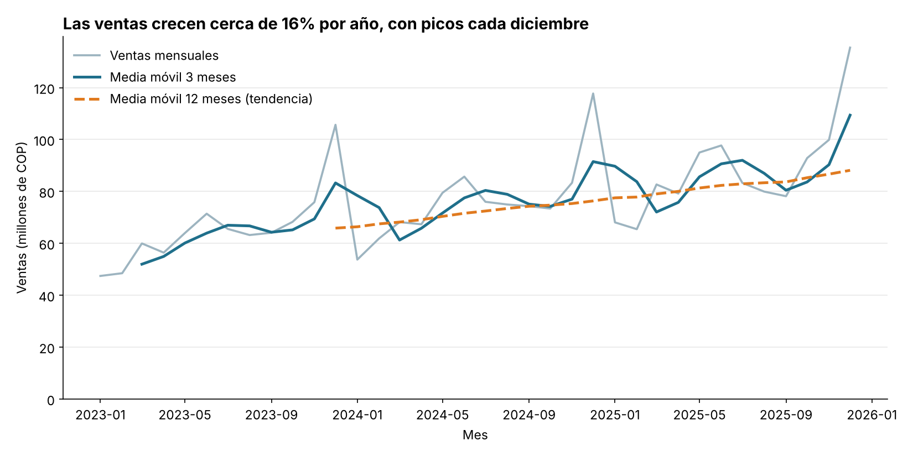
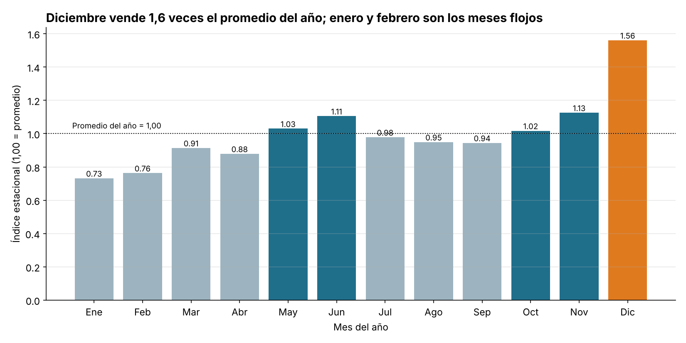

# Semana 14 · Corte 3 — Análisis temporal y visualización

**Asignatura:** Ciencia de Datos · **Entrega individual** · **Autor:** Álvaro Augusto Andrade Quesada

Análisis de una serie temporal de ventas diarias de una tienda (2023-2025): agregación con `resample`,
media móvil, tendencia, estacionalidad, dos visualizaciones y optimización de una consulta SQL.

> **Nota sobre los datos:** `datos_ventas.csv` es un dataset **sintético** (generado con `generar_datos.py`,
> semilla fija) con 4.381 registros diarios por producto (Camisetas, Jeans, Zapatos, Accesorios).

## Estructura

| Archivo | Descripción |
|---|---|
| `generar_datos.py` | Genera `datos_ventas.csv` |
| `analisis_temporal.py` | Resample, media móvil, tendencia, estacionalidad y gráficos |
| `optimizacion_sql.py` | Benchmark de la consulta SQL antes/después (SQLite) |
| `consulta_sql.sql` | Consulta original y optimizada |
| `serie_mensual.csv` | Serie mensual con medias móviles |
| `grafico_evolucion.png`, `grafico_comparacion.png` | Visualizaciones |

## Cómo ejecutar

```bash
pip install pandas numpy matplotlib
python generar_datos.py
python analisis_temporal.py
python optimizacion_sql.py
```

## 1. Serie temporal

- Los datos diarios se agregan a **total mensual** con `df["valor"].resample("MS").sum()`.
- Se calculan dos medias móviles con `rolling`: **3 meses** (suaviza el ruido de corto plazo) y **12 meses**
  (elimina la estacionalidad y deja ver la tendencia).
- **Tendencia:** creciente. Ventas anuales: 790,3 M (2023), 916,1 M (2024) y 1.057,7 M (2025) de COP,
  es decir, **+15,9 %** y **+15,5 %** anual.
- **Estacionalidad:** índice estacional (1,00 = promedio del año). Diciembre es el pico (**1,56**), seguido de
  noviembre (1,13) y junio (1,11); enero (**0,73**) y febrero (0,76) son los valles.

## 2. Visualizaciones

**Evolución** — línea con ventas mensuales y medias móviles; eje Y desde cero.



**Comparación** — barras con el índice estacional por mes; eje Y desde cero y línea de referencia en 1,00.



Principios aplicados: título que expresa la conclusión, ejes con unidades, eje Y desde cero, un color de
énfasis (diciembre) y sin elementos decorativos.

## 3. Optimización de consulta SQL

Prueba sobre una tabla `ventas` de 1.000.000 de filas (SQLite).

**Antes**
```sql
SELECT *
FROM ventas
WHERE strftime('%Y', fecha) = '2025' AND strftime('%m', fecha) = '03';
```
Plan: `SCAN ventas` · **~321 ms**

**Después**
```sql
CREATE INDEX idx_ventas_fecha ON ventas(fecha);

SELECT fecha, producto, unidades, valor
FROM ventas
WHERE fecha >= '2025-03-01' AND fecha < '2025-04-01';
```
Plan: `SEARCH ventas USING INDEX idx_ventas_fecha` · **~48 ms** · mismas 28.466 filas.

**Resultado: ~6,8 veces más rápida (≈85 % menos tiempo).** Los tiempos varían un poco entre ejecuciones y equipos.

**Por qué mejora:**
1. **Columnas necesarias:** se evita `SELECT *`, así se leen y transfieren menos datos (la tabla tiene una columna de texto larga que no hace falta).
2. **Filtro por rango:** aplicar una función a `fecha` en el `WHERE` obliga al motor a evaluarla fila por fila e impide usar un índice (escaneo completo). Un rango sobre la columna "limpia" sí puede usarlo.
3. **Índice:** `idx_ventas_fecha` permite saltar directo al bloque de marzo de 2025 en lugar de recorrer 1.000.000 de filas.

## Findings

The daily sales data were aggregated into monthly totals using `resample`, and a 3-month and a 12-month moving average were calculated to reveal the underlying patterns. The series shows a clear upward trend: yearly sales grew from about 790 million COP in 2023 to about 1,058 million COP in 2025, an increase of roughly 16% per year. A strong seasonal pattern repeats every year, with December as the peak month (seasonal index of 1.56) and January and February as the weakest months (0.73 and 0.76). The first chart is a line chart that shows the evolution of monthly sales together with both moving averages, where the 12-month average isolates the growth trend from the seasonal peaks. The second chart is a bar chart that compares the seasonal index of each month against the yearly average, highlighting December, November and June as the strongest months. Based on these findings, inventory and promotions should be planned around the November–December peak, while campaigns could be used to boost the low-demand months at the start of the year. In addition, rewriting the slow SQL query with a date range filter, only the needed columns and an index made it about 6.8 times faster on a one-million-row table.
